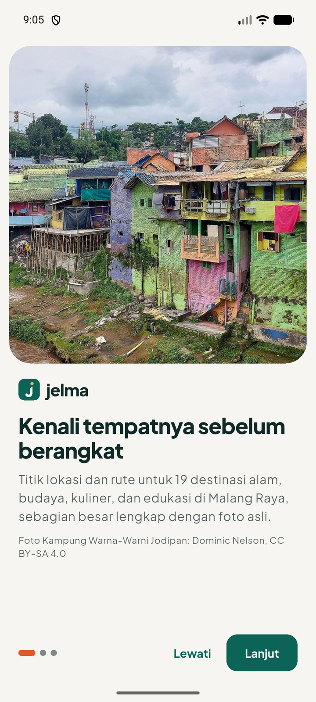
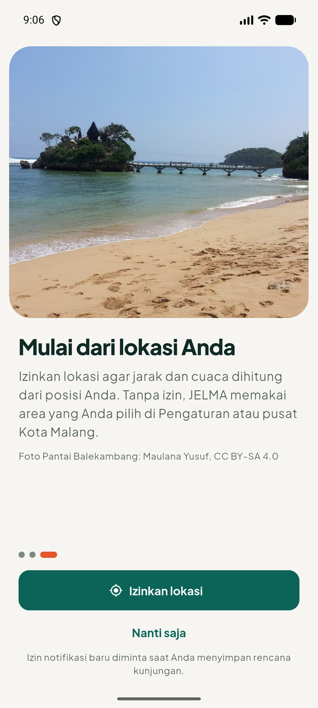
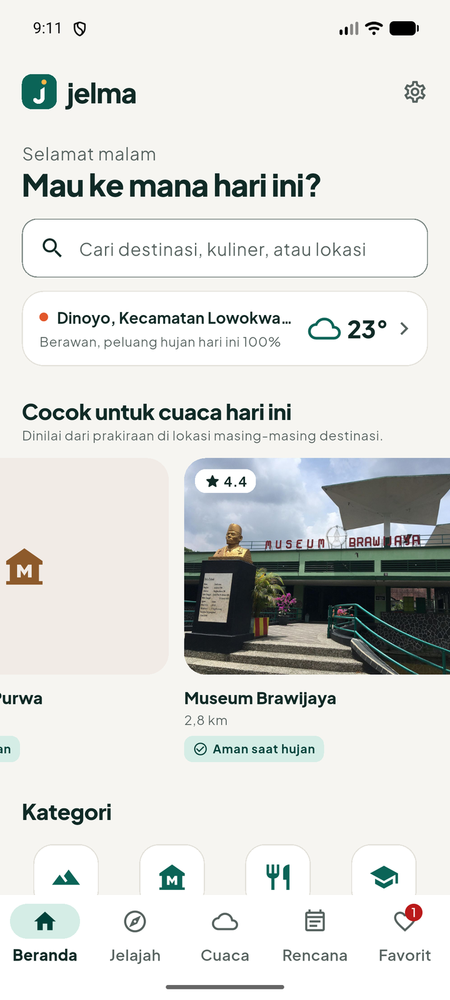
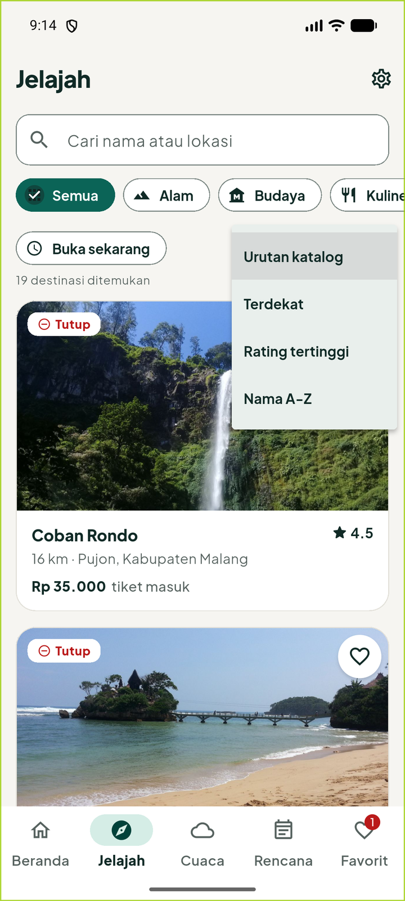
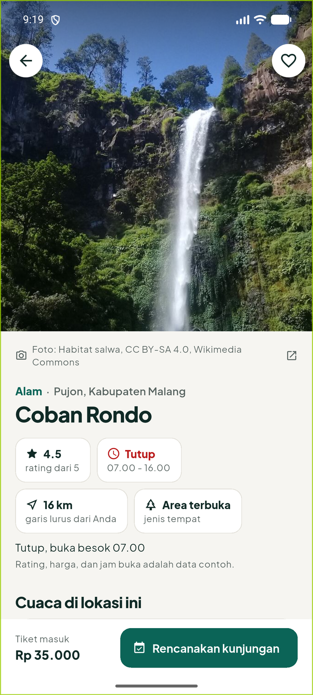
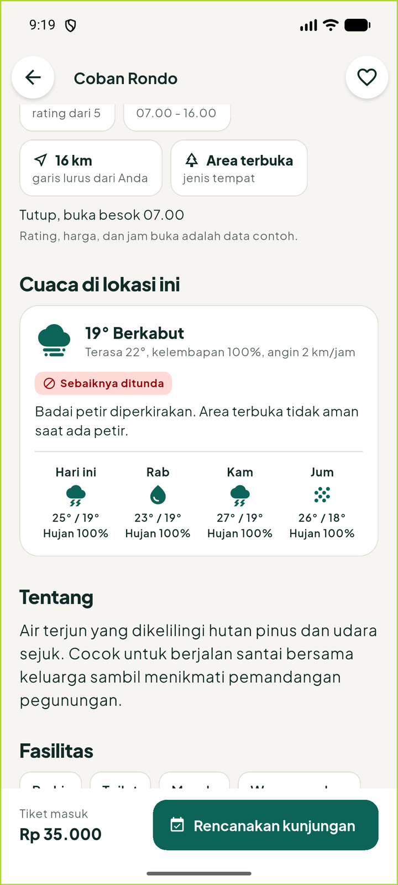
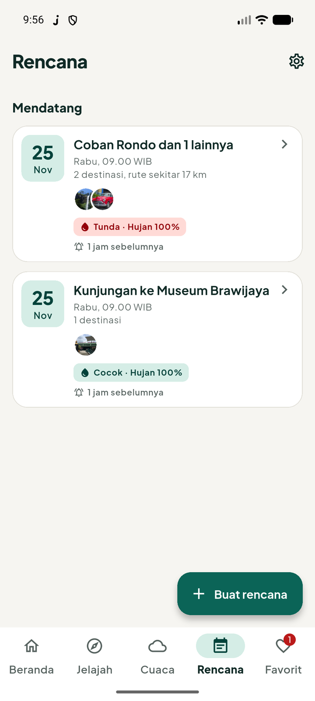
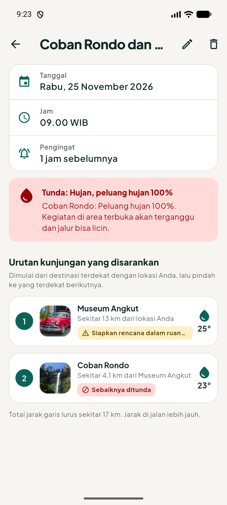
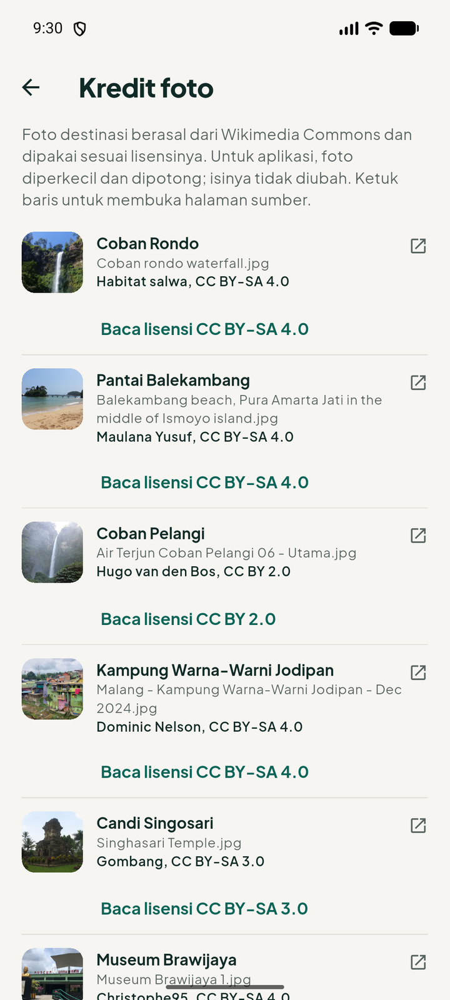
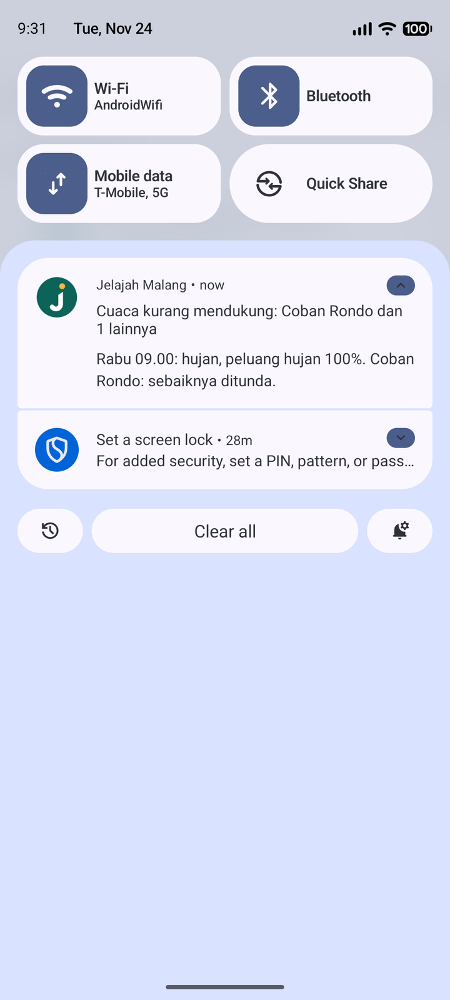

# Jelajah Malang (JELMA)

Aplikasi wisata Malang Raya yang dibuat dengan Flutter untuk mata kuliah **Mobile Programming**.
Versi 1 dibuat sebagai tugas **Ujian Tengah Semester (UTS)**; versi 2 melanjutkannya sebagai proyek
**Ujian Akhir Semester (UAS)** dengan lokasi dinamis, prakiraan cuaca, rencana kunjungan, dan
notifikasi. Versi 2.1 merancang ulang antarmuka dengan foto asli destinasi, huruf, warna, pengenalan,
dan logo baru. Repositori ini berdiri sendiri, terpisah dari tugas modul praktikum lainnya.

| Identitas | Keterangan |
| --- | --- |
| Nama | Rafiq Alhariri Andriansyah |
| NIM | 240605110178 |
| Kelas | Mobile Programming Praktikum Mobile |
| Program Studi | Teknik Informatika, Fakultas Sains dan Teknologi |
| Universitas | UIN Maulana Malik Ibrahim Malang |
| Dosen Pengampu | Roro Inda Melani, M.T., M.Sc. |

| Versi | Tugas | Isi |
| --- | --- | --- |
| 1.0 (commit `37ee01c`) | UTS | Katalog 12 destinasi, empat halaman, data JSON lokal |
| 2.0 (commit `dd2b086`) | UAS | Lokasi dinamis, cuaca Open-Meteo, rencana dan notifikasi, sembilan halaman, 19 destinasi |
| 2.1 | UAS | Desain ulang: foto berlisensi bebas untuk 12 destinasi, Plus Jakarta Sans, palet baru, pengenalan, logo, ikon adaptif, dan layar pembuka; sebelas halaman |

## Fitur

| Fitur | Penjelasan |
| --- | --- |
| Foto destinasi | 12 dari 19 destinasi memakai foto asli dari Wikimedia Commons berlisensi CC BY atau CC BY-SA. Kredit tampil di bawah foto pada Detail dan dikumpulkan pada halaman Kredit foto; destinasi lain memakai gambar pengganti bertuliskan Foto belum tersedia. |
| Pengenalan | Tiga halaman pada pembukaan pertama, dapat dilewati. Halaman terakhir menjelaskan alasan izin lokasi dan menyediakan pilihan Nanti saja. |
| Lokasi dinamis | Posisi diambil dari GPS (paket `geolocator`) dan dinamai dengan *reverse geocoding*, atau dipilih manual dari enam area acuan. Selama lokasi belum diketahui, cuaca memakai Pusat Kota Malang. |
| Jarak dan urutan | Jarak garis lurus (rumus Haversine) ke setiap destinasi, urutan Terdekat pada Jelajah, dan bagian Dekat Anda pada Beranda dengan radius 5 sampai 50 km. |
| Cuaca setempat | Cuaca saat ini dan prakiraan tujuh hari dari Open-Meteo untuk lokasi pengguna dan setiap destinasi, diambil dalam satu permintaan. Kode cuaca WMO dipetakan menjadi cerah, berawan, mendung, berkabut, gerimis, hujan, hujan lebat, badai petir, dan panas. |
| Saran kunjungan | Tingkat Cocok, Waspada, atau Tunda menurut cuaca hari kunjungan dan jenis ruang destinasi (terbuka, tertutup, atau campuran), ditambah saran perlengkapan. |
| Status buka | Buka atau Tutup dihitung dari jam WIB, dengan penyaring Buka sekarang. |
| Rencana kunjungan | Buat, ubah, dan hapus rencana berisi tanggal, jam, destinasi, dan pengingat. Urutan kunjungan disusun dengan heuristik tetangga terdekat. |
| Notifikasi | Pengingat terjadwal (1 jam, 3 jam, atau malam sebelumnya) dan peringatan cuaca untuk rencana dalam 48 jam yang cuacanya kurang mendukung. Izin notifikasi diminta saat rencana pertama disimpan. |
| Data dinamis | Katalog diunduh dari repositori ini; bila gagal, aplikasi memakai salinan unduhan terakhir, lalu aset bawaan. Favorit, pengaturan, dan rencana tersimpan permanen. |
| Rute | Tombol pada halaman Detail membuka petunjuk arah Google Maps ke koordinat destinasi. |

## Halaman

| Halaman | Rute atau komponen | Fungsi |
| --- | --- | --- |
| Pengenalan | `/` pada pembukaan pertama, `/pengenalan` (baru) | Tiga halaman berfoto: isi katalog, cuaca per lokasi, dan izin lokasi |
| Beranda | tab 1 | Salam, kolom cari, ringkasan lokasi dan cuaca, Cocok untuk cuaca hari ini, kategori, Dekat Anda, Populer, Rating tertinggi |
| Jelajah | tab 2 | Kartu berfoto dengan pencarian, kategori, Buka sekarang, dan urutan (katalog, Terdekat, Rating tertinggi, Nama A-Z) |
| Cuaca | tab 3 (baru) | Kartu cuaca, prakiraan tujuh hari, saran perlengkapan, kecocokan setiap destinasi |
| Rencana | tab 4 (baru) | Rencana mendatang dan yang sudah lewat beserta penilaian cuacanya |
| Favorit | tab 5 | Destinasi favorit (tersimpan permanen) |
| Detail | `/detail` | Foto dan kreditnya, fakta ringkas, cuaca di lokasi destinasi, fasilitas, lokasi, rute, dan bilah Rencanakan kunjungan |
| Pengaturan | `/pengaturan` (baru) | Versi, Kredit foto, pengenalan, sumber lokasi, area acuan, radius, notifikasi, notifikasi uji, sumber data |
| Kredit foto | `/kredit-foto` (baru) | Judul, pembuat, lisensi, dan tautan sumber setiap foto |
| Form rencana | `/rencana/form` (baru) | Membuat atau mengubah rencana |
| Detail rencana | `/rencana/detail` (baru) | Urutan kunjungan, cuaca hari kunjungan, ubah, dan hapus |

## Sumber data dan lisensi

| Data | Sumber |
| --- | --- |
| Cuaca | [Open-Meteo](https://open-meteo.com), lisensi CC BY 4.0, tanpa kunci API |
| Koordinat 19 destinasi dan 6 area acuan | Pencarian Nominatim atas data © OpenStreetMap contributors (ODbL), 24 November 2026 |
| Nama tempat dari posisi GPS | Geocoder perangkat melalui paket `geocoding` |
| Foto destinasi | Wikimedia Commons; pembuat dan lisensi setiap foto ada pada tabel di bawah, `assets/data/destinasi.json`, dan halaman Kredit foto |
| Huruf | [Plus Jakarta Sans](https://github.com/tokotype/PlusJakartaSans) karya Tokotype, SIL Open Font License 1.1 (`assets/fonts/OFL.txt`) |
| Rating, harga, dan jam buka | **Data contoh**, bukan informasi resmi |

Tiga hidangan kuliner (bakso, cwie mie, rawon) tersebar di banyak tempat, sehingga koordinatnya adalah titik
perkiraan di pusat Kota Malang dan ditandai `koordinat_perkiraan`.

### Kredit foto

Foto diperkecil menjadi lebar 1.280 piksel dan dipotong ke rasio antara 4:3 dan 16:9; isinya tidak diubah.

| Destinasi | Foto (sumber) | Pembuat | Lisensi |
| --- | --- | --- | --- |
| Coban Rondo | [Coban rondo waterfall.jpg](https://commons.wikimedia.org/wiki/File:Coban_rondo_waterfall.jpg) | Habitat salwa | [CC BY-SA 4.0](https://creativecommons.org/licenses/by-sa/4.0) |
| Pantai Balekambang | [Balekambang beach, Pura Amarta Jati in the middle of Ismoyo island.jpg](https://commons.wikimedia.org/wiki/File:Balekambang_beach,_Pura_Amarta_Jati_in_the_middle_of_Ismoyo_island.jpg) | Maulana Yusuf | [CC BY-SA 4.0](https://creativecommons.org/licenses/by-sa/4.0) |
| Coban Pelangi | [Air Terjun Coban Pelangi 06 - Utama.jpg](https://commons.wikimedia.org/wiki/File:Air_Terjun_Coban_Pelangi_06_-_Utama.jpg) | Hugo van den Bos | [CC BY 2.0](https://creativecommons.org/licenses/by/2.0) |
| Kampung Warna-Warni Jodipan | [Malang - Kampung Warna-Warni Jodipan - Dec 2024.jpg](https://commons.wikimedia.org/wiki/File:Malang_-_Kampung_Warna-Warni_Jodipan_-_Dec_2024.jpg) | Dominic Nelson | [CC BY-SA 4.0](https://creativecommons.org/licenses/by-sa/4.0) |
| Candi Singosari | [Singhasari Temple.jpg](https://commons.wikimedia.org/wiki/File:Singhasari_Temple.jpg) | Gombang | [CC BY-SA 3.0](https://creativecommons.org/licenses/by-sa/3.0) |
| Museum Brawijaya | [Museum Brawijaya 1.jpg](https://commons.wikimedia.org/wiki/File:Museum_Brawijaya_1.jpg) | Christophe95 | [CC BY-SA 4.0](https://creativecommons.org/licenses/by-sa/4.0) |
| Bakso Malang | [Baso Malang Karapitan.JPG](https://commons.wikimedia.org/wiki/File:Baso_Malang_Karapitan.JPG) | Gunawan Kartapranata | [CC BY-SA 3.0](https://creativecommons.org/licenses/by-sa/3.0) |
| Rawon Khas Jawa Timur | [Rawon Setan II.jpg](https://commons.wikimedia.org/wiki/File:Rawon_Setan_II.jpg) | christian razukas from Honolulu, Hawaii | [CC BY-SA 2.0](https://creativecommons.org/licenses/by-sa/2.0) |
| Museum Angkut | [Chevrolet Deluxe, Museum Angkut, Batu, Indonesia, 2017-10-01.jpg](https://commons.wikimedia.org/wiki/File:Chevrolet_Deluxe,_Museum_Angkut,_Batu,_Indonesia,_2017-10-01.jpg) | Crisco 1492 | [CC BY-SA 4.0](https://creativecommons.org/licenses/by-sa/4.0) |
| Jatim Park 1 | [Anjungan Jawa Timur Jawa Timur Park 1 - Tari Topeng Jawa Timur.jpg](https://commons.wikimedia.org/wiki/File:Anjungan_Jawa_Timur_Jawa_Timur_Park_1_-_Tari_Topeng_Jawa_Timur.jpg) | Indonesiagood | [CC BY 4.0](https://creativecommons.org/licenses/by/4.0) |
| Museum Musik Indonesia | [Gedung Kesenian Gajayana - Museum Musik Indonesia.jpg](https://commons.wikimedia.org/wiki/File:Gedung_Kesenian_Gajayana_-_Museum_Musik_Indonesia.jpg) | Edra27 | [CC BY-SA 4.0](https://creativecommons.org/licenses/by-sa/4.0) |
| Selecta | [Selecta Recreational Park.jpg](https://commons.wikimedia.org/wiki/File:Selecta_Recreational_Park.jpg) | consigliere ivan from Bontang, Indonesia | [CC BY 2.0](https://creativecommons.org/licenses/by/2.0) |

Belum berfoto: Cwie Mie Malang, Coban Rais, Pantai Tiga Warna, Candi Jago, Alun-alun Tugu Malang,
Kayutangan Heritage, dan Museum Mpu Purwa.

## Izin Android

| Izin | Kegunaan |
| --- | --- |
| `INTERNET` | Mengunduh katalog, cuaca, dan foto dari jaringan |
| `ACCESS_FINE_LOCATION`, `ACCESS_COARSE_LOCATION` | Lokasi pengguna untuk jarak dan cuaca setempat |
| `POST_NOTIFICATIONS` | Pengingat rencana dan peringatan cuaca (Android 13 ke atas) |
| `RECEIVE_BOOT_COMPLETED`, `VIBRATE` | Menjadwalkan ulang pengingat setelah perangkat dihidupkan |

Pengingat memakai penjadwalan tidak tepat (`inexactAllowWhileIdle`), sehingga tidak memerlukan izin alarm
khusus dan dapat tampil beberapa menit lebih lambat.

## Struktur proyek

```text
lib/
├─ main.dart                 # titik masuk, tema, bahasa Indonesia, pengenalan, rute, pembuatan store
├─ tema.dart                 # palet WarnaJelma dan tema Material 3
├─ navigasi.dart             # pembuka halaman Detail beserta tag Hero foto
├─ models/                   # destinasi dan fotonya, koordinat (Haversine), jam buka, cuaca, saran, rencana, area acuan, format
├─ data/                     # repositori katalog (jaringan, salinan, aset) dan layanan cuaca Open-Meteo
├─ services/                 # layanan lokasi (geolocator, geocoding), notifikasi, dan kumpulan layanan
├─ state/                    # store katalog, pengaturan, lokasi, cuaca, rencana, favorit, notifikasi; StoreScope
├─ pages/                    # sebelas halaman dan kerangka tab
└─ widgets/                  # kartu berfoto, foto destinasi, logo, tombol favorit, chip saran, ikon cuaca, keadaan halaman
assets/
├─ data/destinasi.json       # katalog versi 3 (19 destinasi, 12 foto)
├─ images/destinasi/         # foto destinasi (JPEG, lebar 1.280 piksel)
└─ fonts/                    # Plus Jakarta Sans 400 sampai 800 dan lisensinya
tool/ikon/buat_ikon.py       # pembuat logo, ikon adaptif, ikon notifikasi, dan berkas di docs/logo
docs/riset-desain.md         # riset dan keputusan desain versi 2.1
test/                        # uji model, store, data, dan widget dengan layanan tiruan
```

Semua layanan luar (GPS, cuaca, notifikasi, penyimpanan, jam, pembuka tautan) diberikan lewat
`LayananAplikasi`, sehingga pengujian dapat menggantinya dengan tiruan.

## Struktur data versi 3

```json
{
  "versi": 3,
  "kategori": [{ "id": "alam", "nama": "Alam", "ikon": "terrain" }],
  "destinasi": [{
    "id": 1, "nama": "Coban Rondo", "kategori": "alam",
    "lokasi": "Pujon, Kabupaten Malang", "deskripsi": "...",
    "rating": 4.5, "harga": 35000, "jam_buka": "07.00 - 16.00",
    "fasilitas": ["Parkir", "Toilet"],
    "lat": -7.86962, "lng": 112.48397, "ruang": "terbuka", "populer": true,
    "foto": {
      "berkas": "assets/images/destinasi/01-coban-rondo.jpg",
      "judul": "Coban rondo waterfall.jpg",
      "penulis": "Habitat salwa",
      "lisensi": "CC BY-SA 4.0",
      "url_lisensi": "https://creativecommons.org/licenses/by-sa/4.0",
      "sumber": "https://commons.wikimedia.org/wiki/File:Coban_rondo_waterfall.jpg"
    }
  }]
}
```

Aplikasi mengunduh berkas ini dari `https://raw.githubusercontent.com/Rafiqalha/jelma/main/assets/data/destinasi.json`
dan menolak data dengan `versi` di bawah 3, karena data versi 2 belum memuat foto. Bidang `foto` bernilai
`null` untuk destinasi yang belum berfoto, dan `berkas` boleh berupa alamat `https`, sehingga foto baru
dapat ditambahkan lewat katalog jaringan tanpa merilis ulang aplikasi.

## Desain

Riset dan alasan setiap keputusan ada di [`docs/riset-desain.md`](docs/riset-desain.md). Ringkasnya:

| Aspek | Keputusan |
| --- | --- |
| Warna | Hijau pinus `#0B6457` (teks putih 7,06:1), tinta `#102A26` di latar `#F6F5F1` (13,94:1), teks sekunder `#56625F` (5,82:1), batas kontrol `#7D8985` (3,33:1) |
| Aksen | Jingga `#E2572B` dan `#FFB547`, hanya untuk titik logo, penanda lokasi, penanda halaman pengenalan, dan hati favorit yang aktif |
| Huruf | Plus Jakarta Sans 400 sampai 800 |
| Kartu | Foto di atas dan teks di bawah pada bidang putih; di atas foto hanya ada tombol bundar dan label berlatar putih |
| Label cuaca | Cocok (9,28:1), Waspada (8,28:1), dan Tunda (7,24:1), selalu berupa teks dan ikon |
| Logo dan ikon | Huruf j dengan titik jingga; ikon adaptif vektor dengan lapisan monokrom, ikon notifikasi, dan layar pembuka Android 12 ke atas |
| Gerak | Transisi Hero foto ke Detail dan pergantian halaman pengenalan; keduanya mati bila animasi dinonaktifkan di sistem |
| Tema | Terang saja, karena aplikasi dipakai di luar ruangan pada siang hari |

Komponen bawaan (pemilih tanggal, jam, tooltip) berbahasa Indonesia lewat `flutter_localizations`, dan setiap
data dari jaringan atau GPS memiliki keadaan memuat, kosong, dan galat yang menyebut penyebab dan langkah
berikutnya.

## Tangkapan layar

Diambil dari emulator Android (Pixel 7, Android 17, 1080 × 2400 piksel) pada 24 November 2026 malam dengan
posisi GPS emulator di kampus UIN Malang dan cuaca nyata dari Open-Meteo.

| Pengenalan | Izin lokasi | Beranda | Jelajah |
| --- | --- | --- | --- |
|  |  |  |  |

| Detail | Cuaca destinasi | Cuaca | Kecocokan destinasi |
| --- | --- | --- | --- |
|  |  |  |  |

| Rencana | Detail rencana | Kredit foto | Peringatan cuaca |
| --- | --- | --- | --- |
|  |  |  |  |

Tangkapan layar versi UTS (`uts_*.png`) tetap ada pada folder `docs/screenshots/`.

## Cara menjalankan

Prasyarat: Flutter SDK 3.47 atau lebih baru (Dart 3.13) dan emulator atau perangkat Android dengan
koneksi internet.

```bash
flutter pub get
flutter run
```

Pengujian dan analisis kode:

```bash
flutter test
flutter analyze
```

Logo dan ikon dibuat ulang dengan `python tool/ikon/buat_ikon.py` (memerlukan Pillow).

Catatan untuk Windows: bila proyek berada pada drive yang berbeda dari cache pub (misalnya proyek di D: dan
cache di C:), kompilasi inkremental Kotlin gagal; karena itu `android/gradle.properties` memuat
`kotlin.incremental=false`. Bila Gradle gagal dengan pesan `Unable to establish loopback connection`,
jalankan build dengan folder sementara yang pendek, misalnya `TEMP=C:\t`.

## Pengujian

142 pengujian, seluruhnya lulus pada 24 November 2026 (Flutter 3.47.5):

| Berkas | Jumlah | Cakupan |
| --- | --- | --- |
| `test/model_test.dart` | 32 | Pemformat, Haversine, jam buka, JSON destinasi dan foto, kode WMO, aturan saran, rencana, rute |
| `test/state_test.dart` | 32 | Favorit, pengaturan, lokasi (semua keadaan izin), cuaca, rencana dan notifikasi |
| `test/data_test.dart` | 23 | Penguraian Open-Meteo, galat jaringan, urutan sumber katalog, penolakan data versi 2, keabsahan `destinasi.json` serta berkas dan lisensi setiap foto |
| `test/app_test.dart` | 55 | Alur setiap halaman, pengenalan, foto dan kredit, keyboard, posisi pesan terhadap tombol, keadaan galat dan kosong, lanskap, teks 1,5 kali |

Layanan GPS, cuaca, notifikasi, dan jam diganti tiruan (`test/alat_uji.dart`); jam uji ditetapkan pada
Selasa, 24 November 2026 pukul 09.00 WIB. Pengujian widget memuat berkas huruf asli (`test/font_nyata.dart`)
agar lebar teks sama dengan di perangkat.

## Keterbatasan

- Tujuh destinasi belum berfoto dan memakai gambar pengganti.
- Rating, harga, dan jam buka adalah data contoh.
- Jarak berupa garis lurus, bukan jarak tempuh.
- Peringatan cuaca dihitung saat aplikasi dibuka atau cuaca dimuat ulang, tidak di latar belakang.
- Aplikasi hanya menyediakan tema terang.
- Pengujian dilakukan pada emulator, belum pada perangkat fisik.
