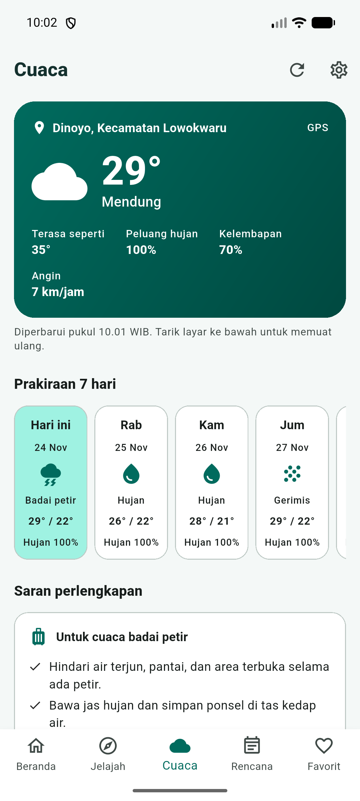
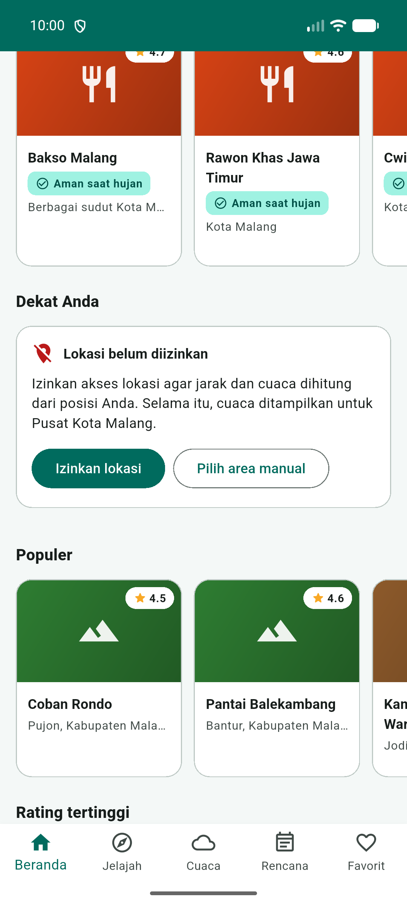
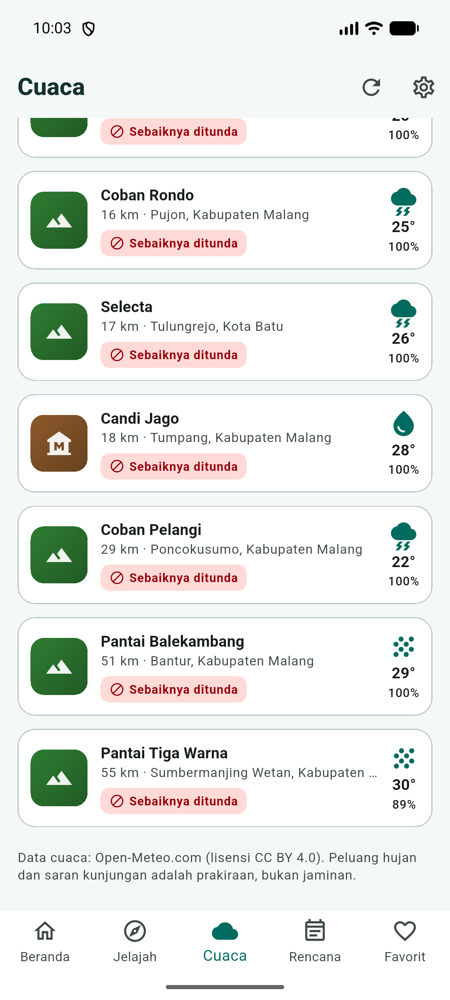
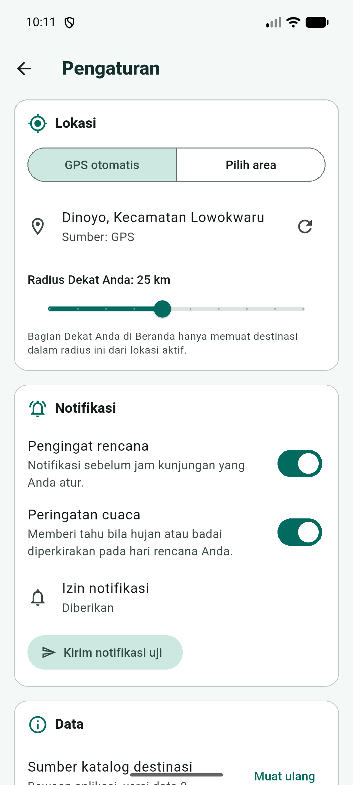

# Jelajah Malang (JELMA)

Aplikasi wisata Malang Raya yang dibuat dengan Flutter untuk mata kuliah **Mobile Programming**.
Versi 1 dibuat sebagai tugas **Ujian Tengah Semester (UTS)**; versi 2 melanjutkannya sebagai proyek
**Ujian Akhir Semester (UAS)** dengan lokasi dinamis, prakiraan cuaca, rencana kunjungan, dan
notifikasi. Repositori ini berdiri sendiri, terpisah dari tugas modul praktikum lainnya.

| Identitas | Keterangan |
| --- | --- |
| Nama | Rafiq Alhariri Andriansyah |
| NIM | 240605110178 |
| Kelas | Mobile Programming Praktikum Mobile |
| Program Studi | Teknik Informatika, Fakultas Sains dan Teknologi |
| Universitas | UIN Maulana Malik Ibrahim Malang |
| Dosen Pengampu | Roro Inda Melani, M.T., M.Sc. |

| Versi | Tugas | Isi |
| --- | --- | --- |
| 1.0 (commit `37ee01c`) | UTS | Katalog 12 destinasi, empat halaman, data JSON lokal |
| 2.0 | UAS | Lokasi dinamis, cuaca Open-Meteo, rencana dan notifikasi, sembilan halaman, 19 destinasi |

## Fitur

- **Lokasi dinamis.** Posisi diambil dari GPS (paket `geolocator`) dan dinamai dengan *reverse geocoding*,
  atau dipilih manual dari enam area acuan. Izin lokasi diminta setelah pengguna membaca alasannya; selama
  lokasi belum diketahui, cuaca memakai Pusat Kota Malang.
- **Jarak dan urutan.** Jarak garis lurus (rumus Haversine) ke setiap destinasi, urutan Terdekat pada
  Jelajah, dan bagian Dekat Anda pada Beranda dengan radius 5 sampai 50 km.
- **Cuaca setempat.** Cuaca saat ini dan prakiraan tujuh hari dari Open-Meteo untuk lokasi pengguna dan
  setiap destinasi, diambil dalam satu permintaan. Kode cuaca WMO dipetakan menjadi cerah, berawan,
  mendung, berkabut, gerimis, hujan, hujan lebat, badai petir, dan panas.
- **Saran kunjungan.** Tingkat Cocok, Waspada, atau Tunda menurut cuaca hari kunjungan dan jenis ruang
  destinasi (terbuka, tertutup, atau campuran), ditambah saran perlengkapan.
- **Status buka.** Buka atau Tutup dihitung dari jam WIB, dengan penyaring Buka sekarang.
- **Rencana kunjungan.** Buat, ubah, dan hapus rencana berisi tanggal, jam, destinasi, dan pengingat.
  Urutan kunjungan disusun dengan heuristik tetangga terdekat.
- **Notifikasi.** Pengingat terjadwal (1 jam, 3 jam, atau malam sebelumnya) dan peringatan cuaca untuk
  rencana dalam 48 jam yang cuacanya kurang mendukung.
- **Data dinamis.** Katalog diunduh dari repositori ini; bila gagal, aplikasi memakai salinan unduhan
  terakhir, lalu aset bawaan. Favorit, pengaturan, dan rencana tersimpan permanen.
- **Rute.** Tombol pada halaman Detail membuka petunjuk arah Google Maps ke koordinat destinasi.

## Halaman

| Halaman | Rute atau komponen | Fungsi |
| --- | --- | --- |
| Beranda | tab 1 | Cuaca di lokasi aktif, kategori, Cocok untuk cuaca hari ini, Dekat Anda, Populer, Rating tertinggi |
| Jelajah | tab 2 | Pencarian, kategori, Buka sekarang, urutan (katalog, Terdekat, Rating tertinggi, Nama A-Z) |
| Cuaca | tab 3 (baru) | Kartu cuaca, prakiraan tujuh hari, saran perlengkapan, kecocokan setiap destinasi |
| Rencana | tab 4 (baru) | Rencana mendatang dan yang sudah lewat beserta penilaian cuacanya |
| Favorit | tab 5 | Destinasi favorit (tersimpan permanen) |
| Detail | `/detail` | Informasi, jarak, status buka, cuaca di lokasi destinasi, rencana, dan rute |
| Pengaturan | `/pengaturan` (baru) | Sumber lokasi, area acuan, radius, notifikasi, notifikasi uji, sumber data |
| Form rencana | `/rencana/form` (baru) | Membuat atau mengubah rencana |
| Detail rencana | `/rencana/detail` (baru) | Urutan kunjungan, cuaca hari kunjungan, ubah, dan hapus |

## Sumber data dan lisensi

| Data | Sumber |
| --- | --- |
| Cuaca | [Open-Meteo](https://open-meteo.com), lisensi CC BY 4.0, tanpa kunci API |
| Koordinat 19 destinasi dan 6 area acuan | Pencarian Nominatim atas data © OpenStreetMap contributors (ODbL), 24 November 2026 |
| Nama tempat dari posisi GPS | Geocoder perangkat melalui paket `geocoding` |
| Rating, harga, dan jam buka | **Data contoh**, bukan informasi resmi |

Tiga hidangan kuliner (bakso, cwie mie, rawon) tersebar di banyak tempat, sehingga koordinatnya adalah titik
perkiraan di pusat Kota Malang dan ditandai `koordinat_perkiraan`.

## Izin Android

| Izin | Kegunaan |
| --- | --- |
| `INTERNET` | Mengunduh katalog dan cuaca |
| `ACCESS_FINE_LOCATION`, `ACCESS_COARSE_LOCATION` | Lokasi pengguna untuk jarak dan cuaca setempat |
| `POST_NOTIFICATIONS` | Pengingat rencana dan peringatan cuaca (Android 13 ke atas) |
| `RECEIVE_BOOT_COMPLETED`, `VIBRATE` | Menjadwalkan ulang pengingat setelah perangkat dihidupkan |

Pengingat memakai penjadwalan tidak tepat (`inexactAllowWhileIdle`), sehingga tidak memerlukan izin alarm
khusus dan dapat tampil beberapa menit lebih lambat.

## Struktur proyek

```text
lib/
├─ main.dart                 # titik masuk, tema, bahasa Indonesia, rute, pembuatan store
├─ models/                   # destinasi, koordinat (Haversine), jam buka, cuaca, saran, rencana, area acuan, format
├─ data/                     # repositori katalog (jaringan, salinan, aset) dan layanan cuaca Open-Meteo
├─ services/                 # layanan lokasi (geolocator, geocoding), notifikasi, dan kumpulan layanan
├─ state/                    # store katalog, pengaturan, lokasi, cuaca, rencana, favorit, notifikasi; StoreScope
├─ pages/                    # sembilan halaman dan kerangka tab
└─ widgets/                  # kartu, chip saran, ikon cuaca, panel izin lokasi, keadaan halaman
assets/data/destinasi.json   # katalog versi 2 (19 destinasi)
test/                        # uji model, store, data, dan widget dengan layanan tiruan
```

Semua layanan luar (GPS, cuaca, notifikasi, penyimpanan, jam, pembuka tautan) diberikan lewat
`LayananAplikasi`, sehingga pengujian dapat menggantinya dengan tiruan.

## Struktur data versi 2

```json
{
  "versi": 2,
  "kategori": [{ "id": "alam", "nama": "Alam", "ikon": "terrain" }],
  "destinasi": [{
    "id": 1, "nama": "Coban Rondo", "kategori": "alam",
    "lokasi": "Pujon, Kabupaten Malang", "deskripsi": "...",
    "rating": 4.5, "harga": 35000, "jam_buka": "07.00 - 16.00",
    "fasilitas": ["Parkir", "Toilet"],
    "lat": -7.86962, "lng": 112.48397, "ruang": "terbuka", "populer": true
  }]
}
```

Aplikasi mengunduh berkas ini dari `https://raw.githubusercontent.com/Rafiqalha/jelma/main/assets/data/destinasi.json`
dan menolak data dengan `versi` di bawah 2. Selama berkas di cabang `main` masih versi UTS, aplikasi
memakai aset bawaan.

## Desain

- Identitas UTS dipertahankan: warna benih hijau toska `#00796B`, warna per kategori (Alam `#2E7D32`,
  Budaya `#8D5A2B`, Kuliner `#D84315`, Edukasi `#1565C0`), Roboto, dan kartu bersudut 16 dp.
- Tingkat saran: Cocok memakai wadah primer tema, Waspada `#FFF0C2` dengan teks `#5C4200` (kontras 8,28:1),
  dan Tunda memakai wadah galat tema. Tingkat selalu ditulis sebagai teks dan ikon.
- Setiap data dari jaringan atau GPS memiliki keadaan memuat, kosong, dan galat yang menyebut penyebab
  dan langkah berikutnya.
- Komponen bawaan (pemilih tanggal, jam, tooltip) berbahasa Indonesia lewat `flutter_localizations`.

## Tangkapan layar

Diambil dari emulator Android (Pixel 7, Android 17, 1080 × 2400 piksel) pada 24 November 2026 dengan
posisi GPS emulator di kampus UIN Malang dan cuaca nyata dari Open-Meteo.

| Beranda | Cuaca | Detail | Rencana |
| --- | --- | --- | --- |
|  |  |  |  |

| Panel izin lokasi | Destinasi per cuaca | Pengaturan | Peringatan cuaca |
| --- | --- | --- | --- |
|  |  |  |  |

Tangkapan layar versi UTS (`uts_*.png`) tetap ada pada folder `docs/screenshots/`.

## Cara menjalankan

Prasyarat: Flutter SDK 3.47 atau lebih baru (Dart 3.13) dan emulator atau perangkat Android dengan
koneksi internet.

```bash
flutter pub get
flutter run
```

Pengujian dan analisis kode:

```bash
flutter test
flutter analyze
```

Catatan untuk Windows: bila proyek berada pada drive yang berbeda dari cache pub (misalnya proyek di D: dan
cache di C:), kompilasi inkremental Kotlin gagal; karena itu `android/gradle.properties` memuat
`kotlin.incremental=false`. Bila Gradle gagal dengan pesan `Unable to establish loopback connection`,
jalankan build dengan folder sementara yang pendek, misalnya `TEMP=C:\t`.

## Pengujian

124 pengujian, seluruhnya lulus pada 24 November 2026 (Flutter 3.47.5):

| Berkas | Jumlah | Cakupan |
| --- | --- | --- |
| `test/model_test.dart` | 30 | Pemformat, Haversine, jam buka, JSON destinasi, kode WMO, aturan saran, rencana, rute |
| `test/state_test.dart` | 32 | Favorit, pengaturan, lokasi (semua keadaan izin), cuaca, rencana dan notifikasi |
| `test/data_test.dart` | 20 | Penguraian Open-Meteo, galat jaringan, urutan sumber katalog, keabsahan `destinasi.json` |
| `test/app_test.dart` | 42 | Alur setiap halaman, keadaan galat dan kosong, teks 1,5 kali |

Layanan GPS, cuaca, notifikasi, dan jam diganti tiruan (`test/alat_uji.dart`); jam uji ditetapkan pada
Selasa, 24 November 2026 pukul 09.00 WIB.

## Keterbatasan

- Rating, harga, dan jam buka adalah data contoh.
- Jarak berupa garis lurus, bukan jarak tempuh.
- Peringatan cuaca dihitung saat aplikasi dibuka atau cuaca dimuat ulang, tidak di latar belakang.
- Ikon peluncur masih ikon bawaan Flutter.
- Pengujian dilakukan pada emulator, belum pada perangkat fisik.
