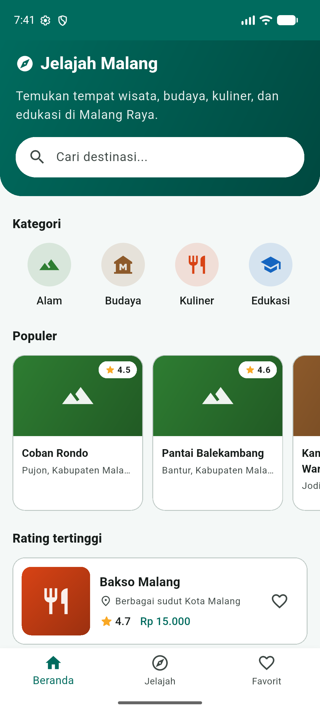
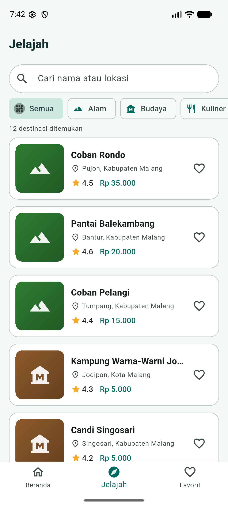
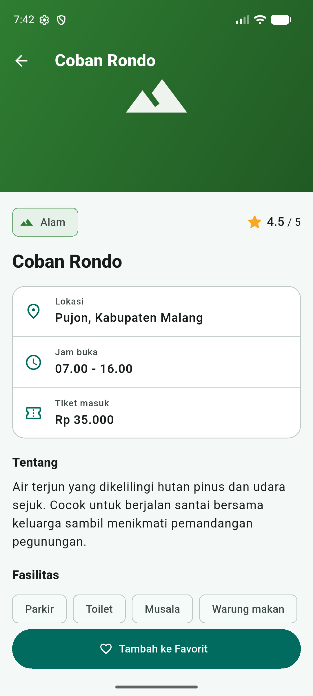
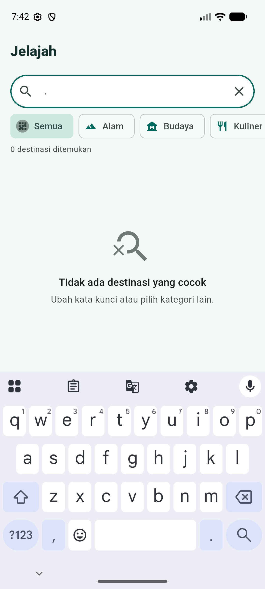

# Jelajah Malang (JELMA)

Aplikasi katalog destinasi wisata Malang Raya yang dibuat dengan Flutter untuk mata kuliah
**Mobile Programming**. Aplikasi ini berawal dari tugas **Ujian Tengah Semester (UTS)** dan
repositori ini dikumpulkan pada **Ujian Akhir Semester (UAS)**. Repositori berdiri sendiri,
terpisah dari tugas modul praktikum lainnya.

| Identitas | Keterangan |
| --- | --- |
| Nama | Rafiq Alhariri Andriansyah |
| NIM | 240605110178 |
| Kelas | Mobile Programming Praktikum Mobile |
| Program Studi | Teknik Informatika, Fakultas Sains dan Teknologi |
| Universitas | UIN Maulana Malik Ibrahim Malang |
| Dosen Pengampu | Roro Inda Melani, M.T., M.Sc. |

## Tema dan tujuan aplikasi

Jelajah Malang membantu pengguna menemukan tempat wisata di Malang Raya yang
dikelompokkan dalam empat kategori: **Alam**, **Budaya**, **Kuliner**, dan
**Edukasi**. Pengguna dapat menelusuri daftar destinasi, menyaringnya berdasarkan
kategori atau kata kunci, membaca informasi lengkap, dan menandai destinasi
favorit. Tujuan pembuatan aplikasi adalah menerapkan konsep layout, widget, dan
navigasi antarhalaman pada Flutter serta menyiapkan struktur data yang mudah
dihubungkan dengan API pada tahap berikutnya.

> Data pada aplikasi ini adalah **data contoh (dummy)**. Nama tempat mengacu pada
> destinasi yang dikenal, tetapi rating, harga, dan jam buka bukan informasi resmi.

## Halaman dan fungsinya

| Halaman | Rute / komponen | Fungsi |
| --- | --- | --- |
| Beranda | tab pertama `BottomNavigationBar` | Sambutan, pintasan pencarian, kategori, destinasi populer, dan rating tertinggi |
| Jelajah | tab kedua | Daftar destinasi dengan penyaring kategori (`ChoiceChip`) dan pencarian nama atau lokasi |
| Favorit | tab ketiga | Daftar destinasi yang ditandai pengguna; menampilkan petunjuk bila kosong |
| Detail | `Navigator.pushNamed('/detail')` | Informasi lengkap destinasi, fasilitas, dan tombol tambah atau hapus favorit |

Navigasi memakai dua mekanisme: `BottomNavigationBar` untuk berpindah antartab dan
`Navigator.pushNamed` dengan argumen objek `Destinasi` untuk membuka halaman Detail.

## Struktur proyek

```text
lib/
├─ main.dart                      # titik masuk, tema, daftar rute, pemuatan data
├─ models/
│  ├─ destinasi.dart              # kelas Kategori dan Destinasi (fromJson/toJson)
│  └─ gaya_kategori.dart          # warna, ikon, dan nama setiap kategori
├─ data/
│  └─ destinasi_repository.dart   # antarmuka DestinasiRepository + pembaca JSON lokal
├─ state/
│  └─ favorit_store.dart          # FavoritStore (ChangeNotifier) dan FavoritScope
├─ pages/
│  ├─ shell_page.dart             # kerangka dengan BottomNavigationBar
│  ├─ beranda_page.dart
│  ├─ jelajah_page.dart
│  ├─ favorit_page.dart
│  └─ detail_page.dart
└─ widgets/
   ├─ destinasi_card.dart         # kartu destinasi yang dipakai berulang
   └─ gambar_kategori.dart        # pengganti foto: gradasi warna + ikon
assets/data/destinasi.json        # data dummy
test/app_test.dart                # pengujian unit dan widget
```

## Data dummy dan kesiapan API

Data dibaca dari `assets/data/destinasi.json` melalui `LocalDestinasiRepository`.
Halaman hanya bergantung pada kelas abstrak `DestinasiRepository`, sehingga untuk
beralih ke API cukup membuat kelas baru, misalnya `ApiDestinasiRepository`, yang
memanggil `http.get` dan mengembalikan `KatalogDestinasi.fromJson(...)`, lalu
memberikannya pada `JelajahApp` di `main.dart`. Struktur JSON:

```json
{
  "kategori": [{ "id": "alam", "nama": "Alam", "ikon": "terrain" }],
  "destinasi": [{
    "id": 1, "nama": "Coban Rondo", "kategori": "alam",
    "lokasi": "Pujon, Kabupaten Malang", "deskripsi": "...",
    "rating": 4.5, "harga": 35000, "jam_buka": "07.00 - 16.00",
    "fasilitas": ["Parkir", "Toilet"], "populer": true
  }]
}
```

## Desain

- **Warna**: skema Material 3 dari warna benih hijau toska `#00796B`; setiap
  kategori memiliki warna sendiri (Alam `#2E7D32`, Budaya `#8D5A2B`, Kuliner
  `#D84315`, Edukasi `#1565C0`).
- **Ikon**: ikon bawaan Material (`terrain`, `museum`, `restaurant`, `school`).
- **Tipografi**: Roboto bawaan Material 3 dengan penekanan tebal pada judul.
- **Responsif**: daftar pada tab Jelajah berupa satu kolom pada layar sempit dan
  grid dua kolom pada layar lebar (`LayoutBuilder`, lebar minimal 640 dp).
- Aplikasi tidak memuat gambar dari internet; gambar destinasi diganti gradasi warna
  kategori dengan ikon.

## Tangkapan layar

Diambil dari emulator Android (Pixel 7, 1080 × 2400 piksel).

| Beranda | Jelajah | Detail | Favorit |
| --- | --- | --- | --- |
|  |  |  |  |

Tangkapan layar lain (pencarian, kategori Kuliner, keadaan kosong, dan orientasi lanskap)
ada pada folder `docs/screenshots/`.

## Cara menjalankan

Prasyarat: Flutter SDK 3.47 atau lebih baru (Dart 3.13) dan emulator atau perangkat Android.

```bash
flutter pub get
flutter run
```

Menjalankan pengujian dan analisis kode:

```bash
flutter test
flutter analyze
```

## Pengujian

`test/app_test.dart` memuat 7 pengujian: format harga, pembacaan JSON, tampilan
Beranda, penyaringan kategori, pencarian dan keadaan kosong, alur Detail ke Favorit,
dan keadaan Favorit kosong.

## Pengembangan lanjutan

- Mengganti `LocalDestinasiRepository` dengan implementasi API.
- Menyimpan daftar favorit secara permanen (misalnya `shared_preferences`).
- Menambahkan foto destinasi dan peta lokasi.
